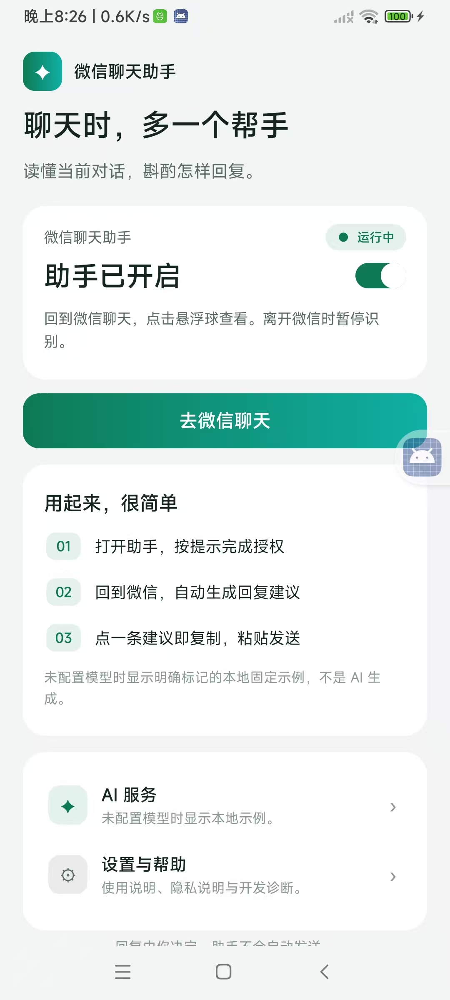
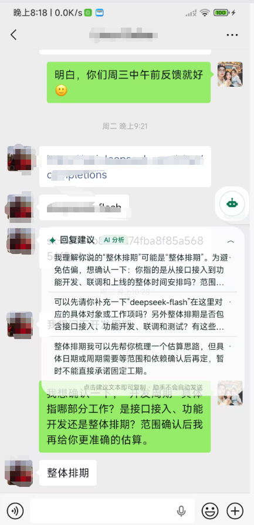
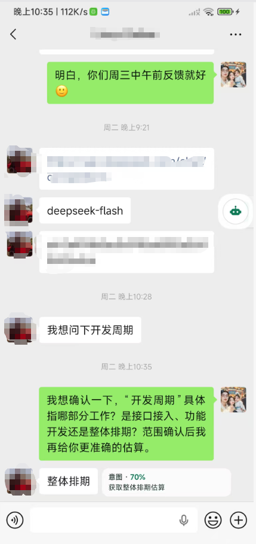
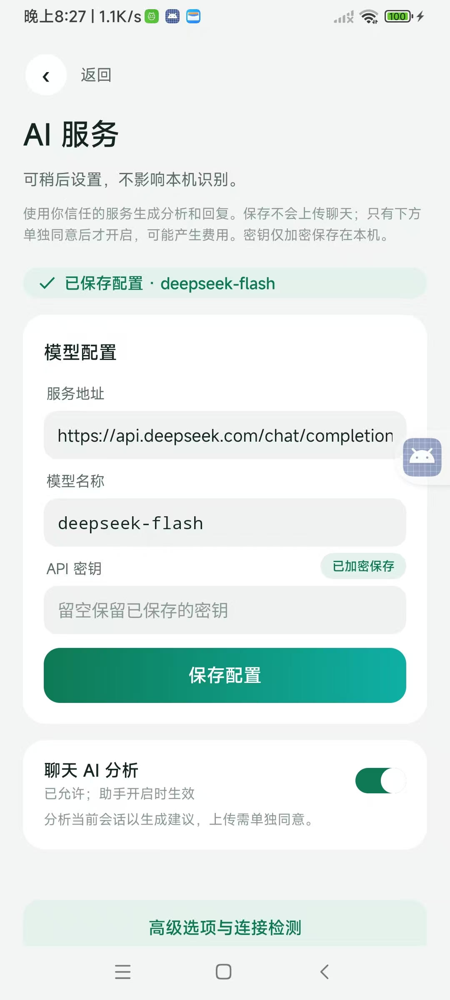

# 微信聊天助手

**聊天时，多一个帮手。**

读懂你正在看的这段对话，替你斟酌该怎么回。

Android 原生应用 · 本机识别 · 全程不替你发送任何一条消息


---

## 这是什么

一个跑在自己手机上的微信聊天辅助工具。

它会看着你当前打开的那个聊天窗口，读出现在屏幕上的几条消息，从对话里判断对方到底想要什么，然后给你几条不同目的的回复草稿 —— 是先把范围问清楚，还是直接给方案，还是先缓一缓，你自己选。

选中一条，复制、粘贴、按发送键，这些都是你做的。**助手不会自动发消息，也不会替你点发送。**

> 不 Root、不 Hook、不伪装系统服务、不修改微信。它只做两件事：看你授权共享的屏幕画面，以及在你确认后往输入框里写字。

---

## 界面一览

### 主界面：开一次，就能用



顶部是助手的开关和运行状态，中间一条「去微信聊天」直接跳转。下面三步讲清楚它的用法：完成授权、回到微信、点一条建议复制发送。

### 微信里就有建议



悬浮球停在聊天页边上，点开就是一张建议卡：几条不同目的的回复，配上判断依据和需要留意的风险。点一下文本即复制，提示条上写着「助手不会自动发送」。

### 不点也能看懂对方意图



很多时候你只是想知道对方什么意思。当前这条消息下方会直接标出意图和置信度，比如「整体排期估算 70%」，不用展开助手也能判断该正面回还是先问清楚。

### 接自己的模型



服务地址、模型名、密钥都可以自己填，兼容 OpenAI 格式接口（图中用的是 deepseek-flash）。配置加密存在本机，保存不会上传聊天。

---

## 核心功能

- **看懂当前对话** —— 识别当前屏幕上可见的消息气泡，区分「对方说的」和「我说的」，不用翻聊天记录、不用导出数据。
- **给几条真正不同的回复** —— 不是把一句话换个说法，而是给出目的不同的选项：确认范围、给估算思路、先反问细节、礼貌延后。
- **说清理由，也标出风险** —— 每条建议附上依据；信息不足时会直接说「范围不明，先别承诺工期」，而不是硬编一个答案。
- **意图识别** —— 在聊天页气泡下方给出对方意图与置信度，一眼知道这句话是催进度、还是只是寒暄。
- **一点即复制** —— 点建议文本直接进剪贴板，附带敏感内容预览提示，粘贴发送由你完成。
- **确认后写入输入框（可选）** —— 有安全可写节点时，可以选择保留 / 追加 / 替换当前草稿；写入后再核对一次，全程不点发送。
- **私聊 / 群聊两套逻辑** —— 群聊要求「讨论话题 + 可见观点 + 原文依据」，成员认不出来就老实标「成员未识别」，不编昵称、不数人头。
- **记住你在意的事** —— 手工维护联系人 / 群的关系背景、表达偏好、重要事项，加密存在本机，只在本次对话里单独授权使用。
- **不想被分析的聊天可以排除** —— 家人、私人群加进排除名单，同名一并排除，扫到标题就直接跳过。
- **悬浮球不碍事** —— 可拖动贴边、不抢焦点；键盘弹出时自动避开输入区，卡片不会盖住你正在打字的地方。
- **模型随你换** —— 任意兼容 `/chat/completions` 的服务都能接；完全没配置时，用明确标注的「本地固定示例」，不会假装那是 AI 生成的。
- **默认关闭的云端** —— 聊天上传默认关，需要单独打开并二次确认；密钥用系统 Keystore 加密，只留在本机。

---

## 用起来，很简单

1. **打开助手，按提示完成授权** —— 系统会问你要屏幕共享，一次授权只在本次会话有效。
2. **回到微信，自动生成回复建议** —— 打开任意聊天，悬浮球会告诉你有没有读到新内容。
3. **点一条建议即复制，粘贴发送** —— 内容你看着改，发送键你按。

离开微信时识别会暂停，不会在你没看的时候偷跑。

---

## 隐私与边界

- **只在你授权过的画面上工作。** 没有 Root、没有 Hook、没有注入微信进程，也不模拟点击替你操作。
- **画面和文字只在内存里走一遍。** 不写截图文件、不写聊天原文日志；助手停止或切换会话，旧结果立刻作废。
- **上传要你点头。** 云端分析默认关闭，只在你明确打开、并且确认当前会话后才发送可见正文，最多一次一小段；已经发出去的数据无法撤回。
- **密钥归你。** 加密保存在本机，不进备份、不回显，也不经过任何中转服务器。
- **随时能停。** 通知栏和助手页都有停止入口，停止即断开共享，不需要卸载。

---

## 已知限制

这个项目仍在开发验证阶段，有些事它现在还做不好，先讲清楚：

- OCR 会认错字，彩色 emoji 目前只能标成「未解析表情」，不能可靠读出具体含义。
- 群聊成员识别、部分机型与微信版本的窗口适配仍在验证；横屏、分屏等场景未全覆盖。
- 草稿写入依赖微信输入框存在可写节点。当前多数设备上不满足这个条件，会退回「复制 + 手动粘贴」。
- 回复质量取决于你接入的模型；未配置模型时给的是本地固定示例，仅供界面演示。
- 屏幕共享与无障碍权限由系统控制，不同厂商 ROM 的授权流程和后台策略差异较大。
- 请在**自己的账号、自己的设备**上用于个人沟通辅助，遵守微信用户协议与当地法律法规。不要用于群发营销、骚扰或自动化刷屏。

---

## 构建

环境：JDK 17、Android SDK 34（最低支持 Android 8.0）。

```bash
./gradlew assembleDebug
```

产物：`app/build/outputs/apk/debug/app-debug.apk`

Windows 下也可以用仓库内的脚本：

```powershell
.\build.ps1
.\build.ps1 -Install -DeviceSerial '实际设备序列号'
```

核心代码在 `app/src/main/java/`，独立的验证工程在 `verification/`。开发过程中的逐版本验证记录与本机测试证据不随仓库发布，仅在本地留存。

---

## 许可

本项目采用**非商业用途许可**发布：个人学习、研究、自用免费，**未经作者事先书面授权不得用于任何商业用途**。详见 [LICENSE](LICENSE)。

---

如果你觉得这个思路有意思，欢迎提 Issue 聊聊；也欢迎把它改成更适合你自己的样子。
